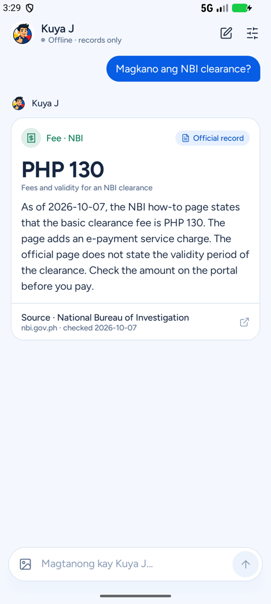
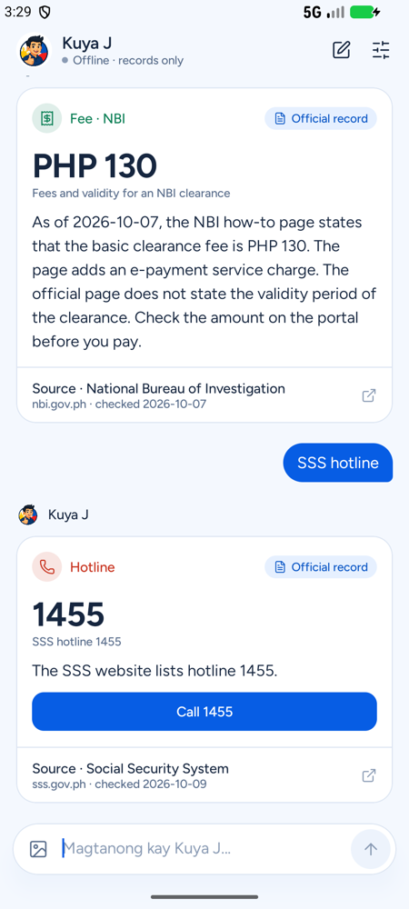
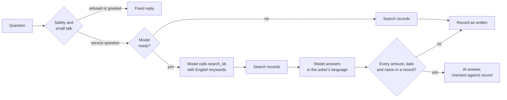

# Kuya J

**An offline assistant for Philippine government services.** Ask how much an NBI clearance costs, what the SSS
hotline is, or when the next holiday falls, in Tagalog, Cebuano, Ilocano, English or another Philippine language,
and Kuya J answers on your phone, without internet, from saved public records. Every answer shows where it came
from and the date it was checked.

Kuya J is a [BetterGov.ph](https://bettergov.ph) project. The web version runs at
[chat.bettergov.ph](https://chat.bettergov.ph); this repository is the offline mobile app.

**Model:** [sapinsapin/kuya-j-gemma4-e2b](https://huggingface.co/sapinsapin/kuya-j-gemma4-e2b) on Hugging Face,
Gemma 4 E2B fine-tuned for Kuya J (LiteRT-LM for Android, GGUF for llama.cpp, and the LoRA adapter).

<p>
  
  
  
  
</p>

## Why it exists

Government information in the Philippines is mostly online, in English, and spread across dozens of agency
websites. Many people who need it most have little or no data, speak another Philippine language at home, and
end up guessing or paying a fixer. Kuya J puts the answers on the phone itself, in the person's own language, with
the source attached so they can trust it. [Read the full vision](docs/vision.md).

## What it does

| Feature | In short | Docs |
|---|---|---|
| Works offline | Records and the AI model live on the phone; chat never needs the internet | [Architecture](docs/architecture.md) |
| Answers from records only | Every fee, date and name in an answer must appear in a saved record, or the record is shown instead | [How answering works](docs/answering.md) |
| Any Philippine language | The model replies in the language of the question | [The v3 model](docs/model-v3.md) |
| Answer cards | The key value (fee, hotline, date) large, a call button for hotlines, the source and its checked date | [The app UI](docs/ui.md) |
| Search | A small BM25 search engine over the records, tolerant of typos and partial words | [Search](docs/search.md) |
| Safety | Refuses political opinions, legal and medical advice, and prompt probing; never invents an official | [Safety](docs/safety.md) |
| Reads photos | Attach a photo of a form or sign; the model reads it and Kuya J answers from the records | [How answering works](docs/answering.md#photos) |
| Record updates | Signed record bundles download on Wi-Fi; a bad signature is rejected and the old records stay | [Record sync](docs/sync.md) |
| On-device model | [Kuya J v3](https://huggingface.co/sapinsapin/kuya-j-gemma4-e2b): Gemma 4 E2B fine-tuned for Kuya J, run with LiteRT-LM on GPU or CPU | [On-device model](docs/on-device-model.md) |
| Works without the model | Before the 3 GB model is downloaded, Kuya J answers with the matching record as written | [How answering works](docs/answering.md#without-the-model) |

## How it works



The [architecture page](docs/architecture.md) walks through each part.

## Project layout

```
kuya-j/
├── shared/       Compose Multiplatform: chat logic, search, safety and all screens (Android + iOS-ready)
├── androidApp/   Android: on-device model (LiteRT-LM), model download, record sync, built-in records
└── docs/         Feature and workflow documentation
```

The training data, fine-tuning and evaluation live in a separate evals repository; [the dataset](docs/dataset.md)
and [the v3 model](docs/model-v3.md) pages describe them.

## Quick start

Requirements: JDK 17+, Android SDK (API 37), an arm64 phone or emulator.

```bash
./gradlew :androidApp:installDebug       # build and install
./gradlew :androidApp:testDebugUnitTest  # unit tests
```

The app runs on its built-in records right away. To get AI answers, open Settings and download the model on
Wi-Fi (3.0 GB, from [Hugging Face](https://huggingface.co/sapinsapin/kuya-j-gemma4-e2b)), or push a model file for
testing. [Development guide](docs/development.md).

## Documentation

- **The app:** [Architecture](docs/architecture.md) · [How answering works](docs/answering.md) ·
  [Records](docs/records.md) · [Search](docs/search.md) · [Safety](docs/safety.md) · [The app UI](docs/ui.md) ·
  [On-device model](docs/on-device-model.md) · [Record sync](docs/sync.md) · [Development](docs/development.md)
- **The AI:** [The synthetic dataset](docs/dataset.md) · [The v3 model](docs/model-v3.md) · [Model on Hugging Face](https://huggingface.co/sapinsapin/kuya-j-gemma4-e2b)
- **Why:** [Vision](docs/vision.md)

## Credits

- [Airgap](https://github.com/xmpuspus/airgap) by Xavier Puspus: Kuya J's answering pipeline, safety layer, record
  format and signed sync are ported from Airgap, and the 27 built-in records come from its government example.
- [Gemma 4](https://ai.google.dev/gemma) by Google, run with [LiteRT-LM](https://github.com/google-ai-edge/LiteRT-LM).
- [BetterGov.ph](https://bettergov.ph) volunteers, whose public data and guides Kuya J builds on.

## Licence

Code: MIT, see [LICENSE](LICENSE). Third-party parts keep their own terms: see
[THIRD_PARTY_NOTICES.md](THIRD_PARTY_NOTICES.md). Kuya J is not operated by any government agency; check the
agency's official page before acting on a fee, hotline or office holder.
