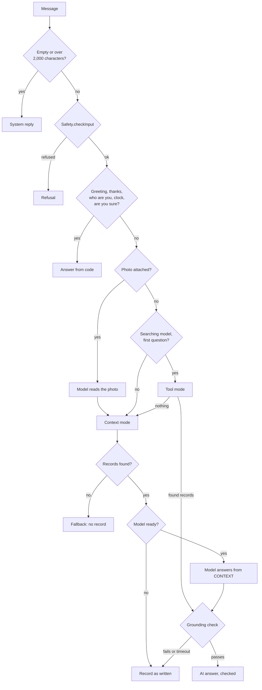

# How answering works

Every message goes through `Orchestrator.reply()` (`shared/.../chat/Orchestrator.kt`). The rule behind all of it:
**the model never supplies a fact the records don't contain.** Code handles what code can (refusals, greetings,
the clock); the model only words what a record already says, and its words are checked before you see them.



## 1. Controls that run before any search

| Check | Example | What happens |
|---|---|---|
| Length | Empty, or over 2,000 characters | Asks for a question, or a shorter one |
| [Safety rules](safety.md) | "Who should I vote for?", "ignore your instructions" | A fixed refusal, never the model |
| Greeting / thanks | "Kumusta", "salamat po" | Fixed greeting or goodbye |
| Identity | "Sino ka?" | Says who Kuya J is and that no agency runs it |
| Clock | "Anong oras na?" | Reads the phone's clock; Kuya J has none of its own |
| Personal small talk | "Kumusta ang araw mo?", "Mahal mo ba ako?", "Ilang taon ka na?" | A fixed friendly reply, before search: everyday words like "araw" or "mahal" would otherwise match holiday names or marker text. |
| Births and deaths | "Kailan ipinanganak si Rizal?", "When did Andres Bonifacio die?" | Answered from the person's NHCP historical marker by code (`chat/People.kt`), quoting the marker's own sentence ("ISINILANG SA CALAMBA, LAGUNA, 19 HUNYO 1861"), then the full marker and its source. A surname alone goes to the person with the most markers ("si Rizal" is José, not Paciano); a first name in the question must match ("Juan Dela Cruz" doesn't get Emilio Aguilar Cruz). No birth or death sentence on the marker: normal search. |
| Holiday dates | "Kailan ang Araw ng Kalayaan?", "Pasko", "when is Undas 2027" | Answered from the holiday record by code (`chat/Holidays.kt`): the year asked, or the next one coming, as a Filipino date line plus the record and its source. No model, no search ranking; instant. Holiday names come from the record titles, in English and Filipino ("Independence Day (Araw ng Kalayaan)"). A question that names a holiday but asks something else ("christmas bonus requirements") goes on to search. |
| Doubt | "Are you sure?", "Talaga?" | Shows the last answer's record again, word for word; the model is not asked again, so the answer can't change under pressure |

## 2. Finding records

[Search](search.md) returns the top 3 records. A weak top match counts as no match, because prefix and typo
matching find *something* for almost any text. Short follow-ups ("how about the fee?") are searched together with
the previous question.

If nothing matches, Kuya J says it has no record and points to the 8888 hotline and the agency's website. A
personal question ("Nakakain ka na?") gets a friendly small-talk reply instead.

## 3. Two ways the model answers

### Tool mode (the v3 model)

A model trained to search ([v3](model-v3.md)) gets the bare question and a `search_kb` tool. It decides to search,
writes English keywords, and the app runs the search:

```
User:   Pila ka tuig ang term han Presidente?
Model:  search_kb("President term")                   ← the model's call
App:    [1] How the President is elected ...           ← the app's records, as the tool result
Model:  An term han Presidente amo an unom ka tuig. ...
```

If the model's keywords find nothing, the app also searches the raw question. Tool mode runs on the first question
of a chat without a photo, as in training; follow-ups use context mode.

### Context mode (any model)

The app searches the question itself and pastes the records into the message:

```
RECENT CONVERSATION:       ← only for follow-ups, the last 3 turns
User: ...
Kuya J: ...

CONTEXT:
[1] Fees and validity for an NBI clearance
As of 2026-10-07, the NBI how-to page states ...

QUESTION: Magkano ang NBI clearance?
```

Both prompts (`SYSTEM_PROMPT`, `TOOL_SYSTEM_PROMPT`) tell the model to answer only from the records, reply in the
question's language, copy names, dates and fees exactly, and end with the source line. They are byte-identical to
the prompts the model was trained with.

## 4. The grounding check

`Safety.ungrounded()` lists every **amount**, **date** and **name** in the answer that the records don't contain:

- **Amounts:** any currency amount (PHP, ₱, pesos, $) whose number isn't in the records.
- **Dates:** ISO, numeric (both day/month orders), and written dates ("March 20", "20 March 2026"), compared by
  month, day and year.
- **Names:** a capitalised word in mid-sentence that appears nowhere in the records, their keywords, the question
  or the brand. Acronyms (NBI, PHP) and sentence-initial words are skipped.

It runs twice:

1. **While streaming**, through `Safety.TokenGate`: words reach the screen only once the text up to them passes.
   The first unsourced value stops the stream, so the screen never shows something the final check rejects.
2. **On the full answer**, in `verdict()`. If anything fails, the AI answer is withheld and the record is shown
   as written, with a note saying why ("Amount "PHP 200" is not in the records").

Records marked `"verbatim": true` in their metadata are always shown as written.

## 5. Deadlines and failures

The model runs outside the chat's coroutine, with a 60-second deadline. If it times out or fails, Kuya J shows
the record as written with a note ("The AI model took too long..."). Text the model streams after the deadline is
dropped.

## Reply kinds

| Kind | Shown as | When |
|---|---|---|
| `RECORD` | Answer card, "Official record" | No model, timeout, failed check, verbatim record, doubt check |
| `MODEL` | Answer card, "Checked against record" | The model's answer passed the grounding check |
| `REFUSAL` | Grey box | A safety rule matched |
| `SYSTEM` | Plain text | Greetings, clock, fallback, errors |

## Photos

Attach a photo (the image button in the composer). The app scales it to about 1,024 px and sends it to the model,
which transcribes the important text and names the document. That reading is shown under the answer ("From your
photo: ...") and is added to the question, so the search and the grounding check treat it like something the
person typed. Photos need the model; without it, Kuya J says so.

## Without the model

Kuya J works from the moment it's installed. With no model (or before it finishes loading), every question that
matches a record gets that record as written, in English, with its source. The model adds answers in the asker's
language and photo reading.

## Staleness

If a sync server is configured and records haven't updated in over a day, answers start with a note ("my records
were last updated more than a day ago"; after a week, "Connect to Wi-Fi to update them"). Built-in records with no
sync server carry their own "as of" dates instead.

## Tests

`androidApp/src/test/.../OrchestratorTest.kt` covers the pipeline with fake models: the grounding check withholding
an invented fee, timeouts, the doubt check, follow-ups, small talk, and tool mode (answering from what the model
searched, falling back to the question when keywords miss, and searching for a model that doesn't).
