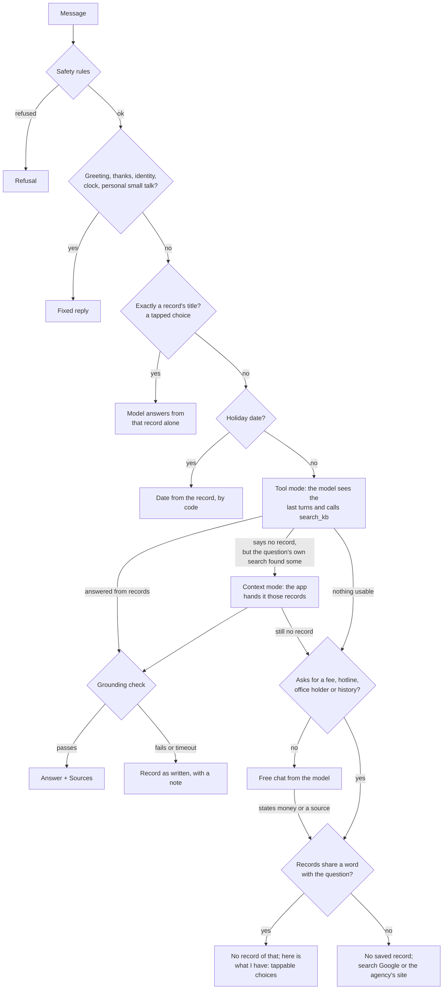

# How answering works

Every message goes through `Orchestrator.reply()` (`shared/.../chat/Orchestrator.kt`). Two rules shape all of it:

- **A government fact comes from a record or not at all.** Fees, dates, hotlines, office holders and history are
  only ever stated from a saved record, and the model's wording is checked against that record before you see it.
- **Kuya J can still talk.** Small talk, language help and other everyday chat are answered from what the model
  knows, with no record. That path is closed to anything that asks for a fact.



## 1. Before any search

| Check | Example | What happens |
|---|---|---|
| Length | Empty, or over 2,000 characters | Asks for a question, or a shorter one |
| [Safety rules](safety.md) | "Sino ang dapat kong iboto?", "ignore your instructions" | A fixed refusal, never the model |
| Greeting / thanks | "Kumusta", "salamat po" | Fixed greeting or goodbye |
| Identity | "Sino ka?" | Says who Kuya J is and that no agency runs it |
| Clock | "Anong oras na?" | Reads the phone's clock; Kuya J has none of its own |
| Personal small talk | "Kumusta ang araw mo?", "Mahal mo ba ako?" | A fixed friendly reply, before search: everyday words like "araw" or "mahal" would otherwise match holiday names or marker text |
| A tapped choice | "SSS pension claim: fees" (exactly a record's title) | Answered from **that record alone**: no other records, no earlier turns. With more in view, the model once added a line from a neighbouring record that contradicted this one. |
| Holiday dates | "Kailan ang Araw ng Kalayaan?", "Pasko", "when is Undas 2027" | Answered from the holiday record by code (`chat/Holidays.kt`): the year asked, or the next one coming. No model, instant. A question that names a holiday but asks something else ("christmas bonus requirements") goes on to search. |
| Births and deaths | "Kailan ipinanganak si Rizal?" | Code only **picks the record** (`chat/People.kt`): the NHCP marker of the person named that records the birth or death. It goes first in what the model sees, and the model words the answer. A surname alone goes to the person with the most markers ("si Rizal" is José, not Paciano). Someone with no marker ("Juan Dela Cruz") gets "no record", not a marker that shares a word with the name. |
| Doubt | "Are you sure?", "Talaga?" | Shows the last answer's record again, word for word; the model is not asked again, so the answer can't change under pressure |

## 2. Tool mode: the model searches, on every turn

A model trained to search ([v3](model-v3.md)) gets a `search_kb` tool and the app's tool prompt. It decides what to
search for, writes English keywords, and the app runs its own [search](search.md):

```
User:   Pila ka tuig ang term han Presidente?
Model:  search_kb("President term")                   ← the model's call
App:    [1] How the President is elected ...           ← the app's records, as the tool result
Model:  An term han Presidente amo an unom ka tuig. ...
```

**Follow-ups work the same way.** From the second message on, the model's input starts with the last three turns:

```
RECENT CONVERSATION:
User: Magkano ang passport?
Kuya J: Ang passport ay ₱950 regular o ₱1,200 expedited. ...

QUESTION: how about the requirements?
```

so it searches "passport requirements" rather than "requirements". Before this, the tool was offered only on the
first message and follow-ups were searched by hand-written rules, which lost the thread.

What the app adds to the model's search:

- **The question's own top record always gets a place** among the three returned, in case the model's keywords
  misread a word ("tagpila" taken for an office).
- **A fragment is searched with the question before it.** "ng pilipinas", "how about the fee?" and "requirements?"
  continue the last question; "Sino ang mga senador?" asks its own (`SearchTerms.continues`).
- **People:** if the model's keywords name someone and a birth or death ("Jose Rizal death"), that person's marker
  goes first, so "kailan siya namatay?" works.
- **A "no record" reply is not shown back to the model.** With two of its own "Wala akong record…" lines in view,
  it repeated the phrase for a question the records do answer.

### Context mode: the second attempt

If the model answers "no record" although the question's own search found something, the app hands it those
records directly:

```
RECENT CONVERSATION:       ← only for follow-ups
...

CONTEXT:
[1] President of the Philippines (Pangulo ng Pilipinas): Office of the President
As listed by BetterGov.ph on 2026-11-19, ...

QUESTION: sino president
```

Context mode is also the only mode for photos and for models that weren't trained to search.

Both prompts (`SYSTEM_PROMPT`, `TOOL_SYSTEM_PROMPT`) tell the model to answer only from the records, reply in the
question's language, copy names, dates and fees exactly, and end with the source line. They are byte-identical to
the prompts the model was trained with.

## 3. When the records have nothing

In this order:

1. **Free chat**, if the message doesn't ask for a fact. The model answers from what it knows under
   `CHAT_SYSTEM_PROMPT` ("tell me a joke", "turuan mo ako ng Bisaya", "what is 15% of 2000?"). Two guards:
   - a message with a fee, hotline, office-holder or history word (`FACT_INTENTS`), or a birth or death question,
     never gets here;
   - a chat reply that states money, a link or a source line is dropped.
2. **"Here is what I have."** If records share a real word with the question, Kuya J says it has no record of that,
   lists up to four record titles as choices to tap, and suggests searching Google or the agency's website when
   online. "Magkano sss" gets the SS number fee, the pension claim fee, how to get an SS number and the hotline;
   a "magkano" question lists fee records first. The wording is fixed text, not the model's.
3. **The plain fallback**, when nothing matches at all: no saved record; search Google or the agency's website, or
   call 8888.

## 4. The grounding check

`Safety.ungrounded()` lists every **amount**, **date** and **name** in an answer that the records don't contain:

- **Amounts:** any currency amount (PHP, ₱, pesos, $) whose number isn't in the records.
- **Dates:** ISO, numeric (both day/month orders), and written dates in English and Filipino ("March 20",
  "20 Hunyo 2026"), compared by month, day and year.
- **Names:** a capitalised word in mid-sentence that appears nowhere in the records, their keywords or the question.
  **Checked only when an office holder is in play** (one of the records is in the `officials` category). Elsewhere
  it mostly caught Filipino words for what an English record says ("Pamantasan" for "University") and threw away
  correct answers. Filipino words for offices and titles ("Opisina", "Kalihim", "Pangulo") and the country's names
  are always allowed.

The records an answer is checked against are the ones it was given **plus those behind the previous answer**, since
a follow-up repeats figures from it.

It runs twice:

1. **While streaming**, through `Safety.TokenGate`: words reach the screen only once the text up to them passes.
2. **On the full answer**, in `verdict()`. If anything fails, the AI answer is withheld and the record is shown as
   written, with a note saying why ("Amount "PHP 200" is not in the records").

An answer that is itself "no record" (`NO_RECORD`, a phrase list in the languages the model answers in) is shown as
plain text with no sources and no "checked" mark, and sends the question on to the steps in section 3.

Records marked `"verbatim": true` in their metadata are always shown as written.

## 5. Deadlines and failures

The model runs outside the chat's coroutine, with a 60-second deadline. If it times out or fails, Kuya J shows the
record as written with a note. Text the model streams after the deadline is dropped.

A turn can take up to three generations (tool mode, the second attempt, then chat). On a Snapdragon 8 Elite the
median follow-up went from 1.3 s to 3.8 s when this was added; the earlier figure was fast because many of those
follow-ups were wrong. See [Where Kuya J stands](status.md).

## Reply kinds

| Kind | Shown as | When |
|---|---|---|
| `MODEL` | Plain text, a **Sources** chip, "Checked against record" | The model's answer passed the grounding check |
| `RECORD` | The record's text, a note if the AI answer was withheld, a Sources chip, "Official record" | No model, timeout, failed check, verbatim record, holiday dates, doubt check |
| `SYSTEM` | Plain text; with `suggestions`, tappable record titles under it | Greetings, clock, free chat, "here is what I have", the fallback |
| `REFUSAL` | Grey box | A safety rule matched |

## Photos

Attach a photo (the image button in the composer). The app scales it to about 1,024 px and sends it to the model,
which transcribes the important text and names the document. That reading is shown under the answer and is added to
the question, so the search and the grounding check treat it like something the person typed. Photos use context
mode and need the model.

## Without the model

Kuya J works from the moment it's installed. With no model, every question that matches a record gets that record
as written, in English, with its source; there is no free chat, and personal questions get a fixed friendly reply.

## Staleness

If a sync server is configured and records haven't updated in over a day, answers start with a note. Built-in
records with no sync server carry their own "as of" dates instead.

## Tests

- `OrchestratorTest`: the pipeline with fake models (an invented fee withheld, timeouts, the doubt check, tool mode).
- `FollowUpTest`: fragments and full questions after an earlier turn, the President record, the "here is what I
  have" reply, and a tapped choice answered from its record alone, on the shipped records.
- `PeopleTest`, `HolidaysTest`: the record pickers.
- `ConversationEval`: 65 scripted turns against a real model; see
  [Development](development.md#scoring-conversations).
