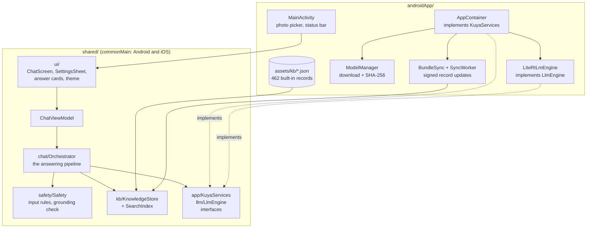

# Architecture

Kuya J is one Compose Multiplatform project with two modules. Everything that doesn't depend on Android lives in
`shared/`, so an iOS app can reuse it later; `androidApp/` adds the parts only Android can do.

## The two modules

| Module | Contains | Why there |
|---|---|---|
| `shared/` | `chat/`, `kb/`, `safety/`, `llm/LlmEngine.kt`, `app/Services.kt`, `ui/`, fonts and icons in `composeResources/` | Pure Kotlin and Compose. It compiles for Android and, as a check, for iOS (`iosArm64`, `iosSimulatorArm64`), so nothing Android-only can creep in. |
| `androidApp/` | `MainActivity`, `KuyaJApp`/`AppContainer`, `llm/` (LiteRT-LM, model download), `sync/` (signed bundles, WorkManager), `assets/` | Uses Android APIs: LiteRT-LM's Android library, `DownloadManager`, `WorkManager`, `BouncyCastle`, the photo picker. |

### The seam: two interfaces

The shared code talks to the platform only through two interfaces, so a test or another platform can supply its
own:

- **`LlmEngine`** (`shared/.../llm/LlmEngine.kt`): `generate()` streams an answer; `generateWithSearch()` lets a
  model that was trained to search call `search_kb` itself. The tests use fakes; Android uses `LiteRtLmEngine`.
- **`KuyaServices`** (`shared/.../app/Services.kt`): what the screens need from the platform: the orchestrator,
  record status, model state and info, and actions (download or delete the model, sync now).
  `AppContainer` implements it on Android.

## Startup

1. `KuyaJApp.onCreate` builds one `AppContainer` per process and schedules record sync (if a sync server is
   configured).
2. `AppContainer` loads the built-in records from `assets/kb/`, then any verified downloaded bundle on top
   ([Record sync](sync.md)).
3. It checks the model file in the background; if it's present and verified, `LiteRtLmEngine` loads it
   ([On-device model](on-device-model.md)).
4. `MainActivity` creates the `ChatViewModel` and shows `KuyaJApp(...)`, the shared root composable: the chat
   screen with the settings sheet over it.

Until the model loads, Kuya J already answers, with the matching record as written.

## One question, end to end

1. The person types or taps a topic. `ChatViewModel.send()` adds their message and an empty bot message.
2. `Orchestrator.reply()` runs the pipeline in [How answering works](answering.md): input rules, search, the model,
   the grounding check.
3. Text streams into the bot message as the model writes, but only words that pass the grounding check reach
   the screen.
4. The final `Reply` replaces the streamed text and carries its kind (record, AI-checked, refusal, system) and
   its source records, which the [answer card](ui.md#answer-cards) shows.

## Where things are

| You want to change | Look in |
|---|---|
| What Kuya J says to greetings, refusals, the fallback | `shared/.../chat/Orchestrator.kt` (companion object) |
| What gets refused | `shared/.../safety/Safety.kt` |
| How records are ranked | `shared/.../kb/SearchIndex.kt`, thresholds in `Orchestrator.search()` |
| The home screen topics and examples | `TOPICS`, `EXAMPLES` in `shared/.../ui/ChatScreen.kt` |
| Colours and type | `shared/.../ui/Theme.kt`, `Categories.kt` |
| Which model file is downloaded | `ModelCatalog` in `androidApp/.../llm/ModelManager.kt` |
| The sync server and its keys | `kuyaj.*` in `gradle.properties` |
| The built-in records | `androidApp/src/main/assets/kb/*.json` |
