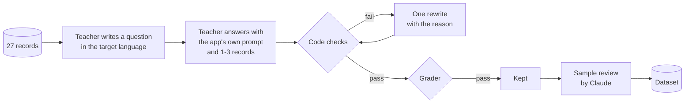

# The synthetic dataset

Kuya J's model learns from **synthetic** training data: questions and answers written by a large model (the
*teacher*) from Kuya J's records, filtered hard, and reviewed. No real conversations are used. The dataset is
`sapinsapin/kuya-j-distill` on Hugging Face (private while under review); the scripts are in the evals repository
(`kuya-j-evals/distill/`).

## Why synthetic data

There's no corpus of people asking government questions in Waray or Bikol, let alone answered from dated records.
A large model can write such questions and answers, but it can't run on a phone. So a big teacher writes examples
from the records, and the small on-device model (Gemma 4 E2B) learns to behave like it: answer in the asker's
language, only from the records, ending with the source.

The goal isn't to teach facts. Facts come from the records at answer time; the model learns **how** to answer.
That's why records change without retraining.

## What one example looks like

The current version (v3) has two formats, matching the two ways the app asks the model
([How answering works](answering.md#3-two-ways-the-model-answers)).

**Tool format**: the model sees the bare question, calls `search_kb`, gets records back, and answers:

```
system:    Kuya J's tool prompt (search first, answer only from results, reply in the asker's language...)
user:      Pila ka tuig ang term han Presidente, ngan ano nga petsa matatapos an term ni Marcos?
assistant: search_kb({"query": "President term Marcos end date"})
tool:      [1] How the President is elected and serves one six-year term
           As of 2026-10-07, Article VII, Section 4 of the 1987 Constitution says ...
assistant: An term han Presidente amo an unom ka tuig. An term ni Marcos matatapos han 30 June 2028.

           Source: https://nlrc.dole.gov.ph/uploads/contents/eLibrary/1987-Constitution.pdf (checked 2026-10-07).
```

**Context format**: the records arrive in the user message (`CONTEXT:` then `QUESTION:`, with
`RECENT CONVERSATION:` for follow-ups), and the model just answers.

## The kinds of examples

| Kind | What it teaches | v3 rows |
|---|---|---|
| `grounded` | The records answer it: answer from them, end with the source | 606 |
| `followup_grounded` | A short follow-up ("how about the fee?") after an earlier exchange | 211 |
| `refusal` | A political opinion is asked: decline first, then give any dated fact the records have | 192 |
| `no_record` | The records don't answer it: say so in one sentence, invent nothing | 110 |
| `followup_no_record` | Same, as a follow-up | 68 |
| **total** | | **1,187** (423 tool format, 764 context format) |

### Languages

| Language | v3 rows | | Language | v3 rows |
|---|---|---|---|---|
| Taglish | 170 | | Kapampangan | 129 |
| Bikol | 159 | | Hiligaynon | 126 |
| Filipino | 136 | | Ilocano | 123 |
| Waray | 131 | | Cebuano | 111 |
| | | | English | 102 |

Regional languages, where the base model struggled most, got the most examples; Filipino, English and Taglish
keep enough that the model doesn't lose them. **Pangasinan and Tausug are not included**: the teacher couldn't
write them reliably (none of the 18 reviewed examples were usable). Native-written examples are the way to add them.

## How it was made



1. **Write.** GLM 5.3 Flash writes a question in the target language from one record, then answers it with the
   app's exact system prompt and 1-3 records (usually the right one first, as the app's search returns them).
   Follow-ups use the app's `RECENT CONVERSATION` format.
2. **Code checks:**
   - the answer is in the right language, by a language-ID model (halo-lid) plus per-language lists of words from
     neighbouring languages that it misses;
   - no English "as of" left in a regional answer;
   - dates copied exactly; every number present in the records;
   - not cut off, not too long (450 characters for an answer, 220 for "no record");
   - not a near-copy of an evaluation question, not a near-duplicate of a kept question.
3. **Grade.** GLM 5.3 (the full model) scores each answer. It's kept only if it's **fully faithful (5/5)**,
   **fluent (4/5 or better)** for a native speaker, correctly labelled answerable or not, and refusals decline in
   their first sentence.
4. **One rewrite.** A failed answer gets one retry with the reason, then all checks again.
5. **The source line is added by code** from the record, never written by the teacher, so it's always exact.

Six records (`evals/holdout.json`) are **never** used in training, so evaluations can test records the model has
never seen.

### What got filtered

Of 5,000 v2 attempts, 1,651 passed. The main reasons for dropping:

| Reason | Attempts |
|---|---|
| Near-duplicate of a kept question | 1,067 |
| Fluency 3 or less | 326 + 171 with faithfulness too |
| Labelled "no record" though the records answer it | 201 |
| Faithfulness 4 (padding, advice, a small change of meaning) | 188 |
| English "as of" left in a regional answer | 123 |

## Versions

| Version | Rows | What changed |
|---|---|---|
| v1 (pilot) | 119 | Context format only. The trained model answered well but never searched. |
| v2 | 1,507 | 5,000 attempts, the filters above, a 99-example review by Claude (Pangasinan and Tausug removed, flagged examples dropped, "the page doesn't state X" answers relabelled as no-record). |
| **v3** | **1,187** | No new teacher answers: v2 restructured. "No record" rows cut to 15% (from about a third) so the model doesn't learn to give up; half of the single-turn rows rewritten in tool format so the model learns to search; refusals that state a fact search first. |

The v3 restructure (`distill/restructure_v3.py`) gets each tool call's keywords from the base model and keeps a row
in tool format only if those keywords find the right record with the app's own search; 28 rows whose keywords
missed stayed in context format.

## Known limits

- **No native-speaker review yet.** The reviewer's confidence: high for English, Filipino, Taglish and Cebuano;
  medium for Hiligaynon, Waray, Bikol and Ilocano; low to medium for Kapampangan.
- **Few records.** 21 training records means topics repeat (NBI, passport, SSS, holidays, officials). A larger
  record set from BetterGov.ph's public data is in progress.
- **Records are dated** (mostly October 2026). That's fine for training, because the model learns to copy from the
  records, not to remember them.
- **Teacher terms.** The answers were written by GLM via Nyolab, and language ID uses halo-lid (CC BY-NC 4.0,
  research use). The dataset stays private until its licence is settled.

## Credits

The 27 source records come from [Airgap](https://github.com/xmpuspus/airgap)'s government-services example
(MIT, © 2026 Xavier Puspus), written from official government pages.
