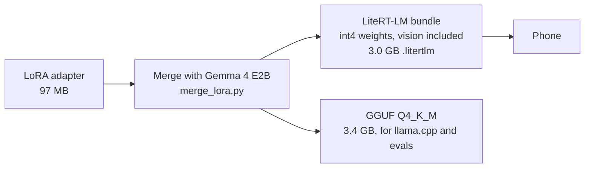

# The v3 model

**Kuya J v3** is Gemma 4 E2B fine-tuned to be Kuya J: when asked about a government service, it searches the
records with English keywords, then answers in the asker's language using only what it found, ending with the
source. It's public on Hugging Face as [sapinsapin/kuya-j-gemma4-e2b](https://huggingface.co/sapinsapin/kuya-j-gemma4-e2b),
and it's what the app downloads.

## Why fine-tune at all

Stock Gemma 4 E2B is a capable small model, but it rarely searches: given Kuya J's `search_kb` tool, it called
it for **40 of 126** questions that needed a record. v3 calls it for **122**.

That matters because in tool mode, a model that doesn't search answers from memory, which is exactly what Kuya
J must never do. (The app's grounding check catches invented facts anyway, but then the person only gets the
record in English.) Fine-tuning also teaches Kuya J's answer style: the fact first, three sentences or fewer, in
the asker's language, ending with the source line.

## Training

| | |
|---|---|
| Base | `google/gemma-4-E2B-it` |
| Method | LoRA, rank 16, alpha 32, dropout 0.05 |
| What's trained | The language model's attention and MLP projections only. Vision and audio stay frozen, so photo reading is unchanged. |
| Trainable parameters | 24.2 million of 5.13 billion (0.47%) |
| Data | [The v3 dataset](dataset.md): 1,187 examples (423 tool format, 764 context format) |
| Loss | Only on what the model writes: its `search_kb` call and its answer. The system prompt, records and tool results are masked, so it learns to search and answer, not to recite records. |
| Schedule | 2 epochs, 142 steps, learning rate 1e-4 (cosine), effective batch 16, up to 2,048 tokens |
| Hardware | One RTX 4090, 21 minutes |
| Eval loss | 0.798 → 0.505 |

The script is `kuya-j-evals/train/train_lora.py`. It renders each example with Gemma's own chat template, so the
training text is exactly what the phone runs.

## From adapter to phone



- The **adapter** is the only trained part; everything else can be rebuilt from it and the public base model.
- **Merging** puts the adapter into the base weights. `merge_lora.py` also restores 60 shared key-value tensors
  that Hugging Face's save step drops but the LiteRT export needs.
- **LiteRT-LM export** (`convert_litertlm.sh`) quantizes weights to 4 bits with LiteRT's own recipe and bundles the
  vision encoder, tokenizer and chat template into one `.litertlm` file.
- **No AWQ or GPTQ was needed:** the 4-bit GGUF made the same search decision as the full-precision model on 134 of
  135 test questions.

## Results

### Does it search when it should? (capri suite, 135 questions)

126 questions need a record; 9 ask who to vote for and need none.

| Model | Searches when needed | Searches on voting questions |
|---|---|---|
| **v3** | **122 / 126** | 9 / 9 |
| v3, 4-bit GGUF | 123 / 126 | 9 / 9 |
| v1 | 0 / 126 | 0 / 9 |
| Stock Gemma 4 E2B | 40 / 126 | 0 / 9 |

v3's keywords find the right record for **89 of 99** answerable questions with the app's search. Most misses are
holiday names ("Araw ng Kagitingan date") that fall under the search's score threshold.

v3 also searches on voting questions, where it should simply decline. The app's [safety rules](safety.md) refuse
those before the model runs, and the next dataset will add examples that decline without searching.

### History questions (40 questions, on a phone)

v3 was never trained on history or on all-capitals marker text. With the app's records and search, on a Snapdragon
8 Elite:

| | Stock Gemma 4 E2B | v3 |
|---|---|---|
| Right from memory, no records | 11 | 11 |
| Right through the app, in the model's own words | 15-18 | 20-21 |
| Answers withheld by the grounding check | 12 | 4 |
| Called `search_kb` | 35-37 | 40 |

(Ranges are two separate runs.) Stock Gemma often answers an English question in Tagalog, which also tripped the
check as it stood then. v3's misses: a year where the record has the full date, "no record" when the date was
there, and once a misread month (Hunyo for Hulyo).

## Speed on the phone

v3 as shipped runs at about half the speed of Google's own Gemma 4 E2B file on the same phone: **21 against 43
tokens per second**. The fine-tune isn't the cause; the two files are built differently. Comparing them section by
section (`litert-lm-peek`, and reading the TFLite graphs):

| In the main model | Google's file | Our export |
|---|---|---|
| Source weights | A quantization-aware "mobile" checkpoint | The normal checkpoint plus the adapter |
| Weights | Mixed 2-, 4- and 8-bit, per channel (0.82 GB) | 4-bit in blocks of 32 (1.29 GB) |
| Conversation memory (KV cache) | 8-bit | 32-bit float |
| Attention and memory updates | Fused GPU operations (`odml.runtime_bmm`, `odml.cache_update`) | Plain matrix multiplies and slice updates |
| Prompt chunk sizes | 128 and 1,024 tokens | 128 only |
| Extra parts | A 44 MB drafter and a "verify" entry point | None |

What was tested, one change at a time:

| Test | Tokens per second | Conclusion |
|---|---|---|
| Google's file with its drafter removed | 41 (unchanged) | The drafter isn't used here; not the cause |
| Our file with the half-precision flag (`prefer_activation_type: fp16`) | 19.5 (unchanged) | Not the cause |
| Our weights re-exported with `--apply_gpu_composites=True --prefill_lengths=128,1024` | **28** | Part of the cause: +33%, first word 2.3 s → 1.5 s, answers unchanged |
| The same with per-channel 4-bit weights (`dynamic_wi4c_afp32`) | 32 | Faster, but the model stopped searching and answered with bare years. Unusable. |

The re-export needs LiteRT-LM 0.20.0 on the phone; on 0.18.1 its GPU code fails to compile. The rest of the gap is
most likely Google's 2-bit weights and 8-bit memory, which come from a checkpoint the public exporter refuses, so
it can't be closed with public tools. That last part is inferred, not tested.

**The re-export is not the app's download yet.** To ship it: upload the file, then update the URL, size and SHA-256
in `ModelCatalog.KUYAJ_V3`. Export command, on a CPU machine with 64 GB of memory (about 7 minutes after the merge):

```bash
python -m litert_torch.generative.export_hf --model=merged --output_dir=out \
  --quantization_recipe=dynamic_wi4b32_afp32 --apply_gpu_composites=True --prefill_lengths=128,1024 \
  --externalize_embedder=True --cache_length=4096 --export_vision_encoder=True \
  --task=image_text_to_text --bundle_litert_lm=True
```

## Known limits

- **Cebuano is often answered in Tagalog**, and **Kapampangan comes out mixed**. The dataset has fewer good
  examples in these than it needs; native-written or native-reviewed examples are the fix.
- **Pangasinan and Tausug** aren't in the training data at all ([why](dataset.md#languages)).
- **Over-searching** on voting questions (above), and on small talk: it searches for "a joke". The app's
  [chat path](answering.md#3-when-the-records-have-nothing) answers those after the search comes back empty.
- **"No record" is a trained reflex.** The prompt it was trained with says to answer "no record" in one sentence
  when the results don't answer the question, so it never says what the results do cover; the app does that
  instead. With two of its own "no record" replies in view, it repeats the phrase even when the record is there.
- **Follow-ups were trained in context format only.** The app now uses tool mode for follow-ups too, with the last
  turns placed before the question. That is outside what v3 saw in training; it works (36 of 37 scripted
  follow-ups) but a v4 dataset should include it.
- **History and marker text** weren't in training: v3 sometimes gives a year where the record has the full date.
- **21 training records**: the model has seen few topics. It doesn't need to know facts, but more varied records
  will make its searching and answering more robust.

## Files on Hugging Face

| File | Size | Use |
|---|---|---|
| `adapter/` | 97 MB | The LoRA adapter, the training result |
| `kuyaj-v3.litertlm` | 3.0 GB | What the app runs |
| `kuyaj-v3-Q4_K_M.gguf` | 3.4 GB | llama.cpp and evaluations |
| `gemma4_tool_template.jinja` | 19 KB | The [patched chat template](on-device-model.md#the-chat-template-fix) |
| `train.log` | 43 KB | The full training log |

## Licence

v3 is a derivative of Gemma 4 and is subject to the [Gemma Terms of Use](https://ai.google.dev/gemma/terms) and its
Prohibited Use Policy.
