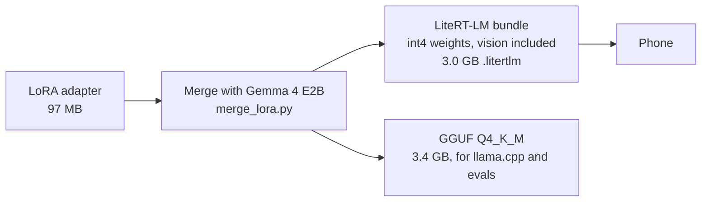

# The v3 model

**Kuya J v3** is Gemma 4 E2B fine-tuned to be Kuya J: when asked about a government service, it searches the
records with English keywords, then answers in the asker's language using only what it found, ending with the
source. It's `sapinsapin/kuya-j-gemma4-e2b` on Hugging Face (private while under review).

## Why fine-tune at all

Stock Gemma 4 E2B is a capable small model, but it rarely searches: given Kuya J's `search_kb` tool, it called
it for **40 of 126** questions that needed a record. v3 calls it for **122**.

That matters because in tool mode, a model that doesn't search answers from memory, which is exactly what Kuya
J must never do. (The app's grounding check catches invented facts anyway, but then the person only gets the
record in English.) Fine-tuning also teaches Kuya J's answer style: the fact first, three sentences or fewer, in
the asker's language, ending with the source line.

## Training

| | |
|---|---|
| Base | `google/gemma-4-E2B-it` |
| Method | LoRA, rank 16, alpha 32, dropout 0.05 |
| What's trained | The language model's attention and MLP projections only. Vision and audio stay frozen, so photo reading is unchanged. |
| Trainable parameters | 24.2 million of 5.13 billion (0.47%) |
| Data | [The v3 dataset](dataset.md): 1,187 examples (423 tool format, 764 context format) |
| Loss | Only on what the model writes: its `search_kb` call and its answer. The system prompt, records and tool results are masked, so it learns to search and answer, not to recite records. |
| Schedule | 2 epochs, 142 steps, learning rate 1e-4 (cosine), effective batch 16, up to 2,048 tokens |
| Hardware | One RTX 4090, 21 minutes |
| Eval loss | 0.798 → 0.505 |

The script is `kuya-j-evals/train/train_lora.py`. It renders each example with Gemma's own chat template, so the
training text is exactly what the phone runs.

## From adapter to phone

- The **adapter** is the only trained part; everything else can be rebuilt from it and the public base model.
- **Merging** puts the adapter into the base weights. `merge_lora.py` also restores 60 shared key-value tensors
  that Hugging Face's save step drops but the LiteRT export needs.
- **LiteRT-LM export** (`convert_litertlm.sh`) quantizes weights to 4 bits with LiteRT's own recipe and bundles the
  vision encoder, tokenizer and chat template into one `.litertlm` file.
- **No AWQ or GPTQ was needed:** the 4-bit GGUF made the same search decision as the full-precision model on 134 of
  135 test questions.

## Results

### Does it search when it should? (capri suite, 135 questions)

126 questions need a record; 9 ask who to vote for and need none.

| Model | Searches when needed | Searches on voting questions |
|---|---|---|
| **v3** | **122 / 126** | 9 / 9 |
| v3, 4-bit GGUF | 123 / 126 | 9 / 9 |
| v1 | 0 / 126 | 0 / 9 |
| Stock Gemma 4 E2B | 40 / 126 | 0 / 9 |

v3's keywords find the right record for **89 of 99** answerable questions with the app's search. Most misses are
holiday names ("Araw ng Kagitingan date") that fall under the search's score threshold.

v3 also searches on voting questions, where it should simply decline. The app's [safety rules](safety.md) refuse
those before the model runs, and the next dataset will add examples that decline without searching.

### On a real phone

On a Qualcomm test phone (LiteRT-LM, GPU), with six questions across languages:

- **6 of 6 facts correct**, each with its source
- First word in **1.9-3.0 s**; full answer in **3.9-7.5 s**

## Known limits

- **Cebuano is often answered in Tagalog**, and **Kapampangan comes out mixed**. The dataset has fewer good
  examples in these than it needs; native-written or native-reviewed examples are the fix.
- **Pangasinan and Tausug** aren't in the training data at all ([why](dataset.md#languages)).
- **Over-searching** on voting questions (above).
- **21 training records**: the model has seen few topics. It doesn't need to know facts, but more varied records
  will make its searching and answering more robust.

## Files on Hugging Face

| File | Size | Use |
|---|---|---|
| `adapter/` | 97 MB | The LoRA adapter, the training result |
| `kuyaj-v3.litertlm` | 3.0 GB | What the app runs |
| `kuyaj-v3-Q4_K_M.gguf` | 3.4 GB | llama.cpp and evaluations |
| `gemma4_tool_template.jinja` | 19 KB | The [patched chat template](on-device-model.md#the-chat-template-fix) |
| `train.log` | 43 KB | The full training log |

## Licence

v3 is a derivative of Gemma 4 and is subject to the [Gemma Terms of Use](https://ai.google.dev/gemma/terms) and its
Prohibited Use Policy.
