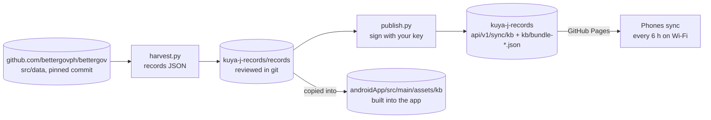

# The records pipeline

How BetterGov.ph's public data becomes the records on every phone. Three steps, all run by hand on the publisher's
computer:



| Repository | Holds |
|---|---|
| [mr-jones123/kuya-j](https://github.com/mr-jones123/kuya-j) (this one) | The tools: `tools/records/harvest.py`, `tools/records/publish.py`; the built-in copy of the records |
| [mr-jones123/kuya-j-records](https://github.com/mr-jones123/kuya-j-records) | The records, the signed manifest and bundles; served at https://mr-jones123.github.io/kuya-j-records |

## 1. Harvest

```bash
python3 tools/records/harvest.py --out ../kuya-j-records/records                 # latest BetterGov commit
python3 tools/records/harvest.py --commit 5ead8c0 --out ../kuya-j-records/records # a specific one
```

Pure standard library. It downloads `src/data` files at one commit (cached in `tools/records/.cache/`) and writes one
JSON array per source, plus `SOURCES.md` with the commit and counts.

| Source in `src/data` | Becomes | How |
|---|---|---|
| `guides/*.md` (19 guides) | One record per section: fees, who can apply, processing time, requirements, steps, what happens next, problems and help. Long sections are split into parts. | **Text copied word for word.** Only Markdown is removed: bold, link syntax (link text kept, URL becomes the record's source), tables become "Header: cell" lines. Citation marks like `[1]` stay. |
| `holidays.ts` | One record per holiday (2025-2027), plus a list of regular and of special days per year | Template: "{name} falls on {weekday, date}. It is a {type}. Basis: {proclamation}." |
| `directory/departments.json` | Each department's head and contacts | Template, using the department directory page and the date BetterGov checked it |
| `directory/executive.json`, `legislative.json`, `judicial.json`, `constitutional.json` | Office heads and contacts; Senate and House leaders; the Supreme Court; government corporations (PhilHealth, SSS, GSIS, Pag-IBIG...) | Template. State universities are left out for now. |
| `philippines_hotlines.json`, `critical_hotlines.json` | One record per hotline, with the main number in the title | Template, numbers copied exactly |
| `visa/philippines_visa_types.json` | One record per visa type with its requirements | Template |

Not harvested: `services/*.json` (names and links only, no fees or steps), `flood_control`, news, site files.

### Dates: "checked" or "listed"

Every record ends with `Source: <url> (checked|listed <date>).`

- **checked**: someone verified the source on that date. Guides use BetterGov's `reviewedAt`, holidays use
  `HOLIDAYS_VERIFIED_ON`, department heads use each department's `officials_source.checked`.
- **listed**: the data has no verification date, so the date is when BetterGov last changed the file. A record says
  "As listed by BetterGov.ph on 2026-11-19, ...", and the answer card shows "listed 2026-11-19".

### Search keywords

Records get English and Filipino search words (topic names, "magkano", "requirements", "kailan ang", Filipino holiday
names like *Pasko* and *Undas*, acronyms like DOH and PhilHealth). Each word appears once per record: repeating a word
raises its BM25 score and buries more specific records.

### Credit on every record

`metadata.via` (the BetterGov.ph page), `metadata.licence` (CC BY-NC-ND 4.0, adapted with permission) and
`metadata.bettergovCommit`. The app's About section credits BetterGov.ph and Airgap.

The script fails if any record is over 1,200 characters, lacks a source line, or repeats an id. Its own checks
(name casing, Markdown cleanup, acronyms) run first.

## 2. Review

`git diff` in `kuya-j-records/records` shows exactly what will change on phones. Check in particular:

- **Office holders**: directory data can lag behind appointments.
- **Fees**: guides are the most detailed source; when our older records disagree, the guide is usually newer.
- **Search**: after big changes, re-measure (below).

### Re-measuring search

The app's search thresholds were measured on this record set (see [Search](search.md#when-a-match-counts)).
When the set changes a lot, check two numbers with the evals repository's copy of the search (`evals/retrieval.py`):

- **Answer recall** on the capri questions, using v3's own keywords: 98 of 99 with 462 records.
- **Off-topic rejection** on small talk in several languages: questions that share no real word with a record must
  find nothing.

## 3. Publish

```bash
uv run --with cryptography tools/records/publish.py \
    --records ../kuya-j-records/records --site ../kuya-j-records \
    --base-url https://mr-jones123.github.io/kuya-j-records
cd ../kuya-j-records && git add -A && git commit -m "Records <date>" && git push
cp records/*.json records/VERSION ../kuya-j-android/androidApp/src/main/assets/kb/   # keep the built-in copy in step
```

`publish.py`:

1. Loads your private key from `~/.kuyaj/signing-key.pem`, or creates it on the first run (readable only by you).
2. Packs every records file into `{"files": {...}, "generatedAt": ...}`, after checking each record has the fields
   the app requires.
3. Signs the exact bytes with Ed25519 and writes `kb/bundle-<version>.json` and the manifest `api/v1/sync/kb`. The
   version is the UTC time, so each release is newer than the last.
4. Runs the app's own checks on what it wrote (length, SHA-256, key id, signature) before you push.
5. Keeps the three newest bundles, so a phone halfway through a download can finish.
6. Writes `records/VERSION`. Copied into the app, it tells the app which downloaded bundles are newer than its
   built-in records.

It prints the app setting `kuyaj.syncPublicKeys=<keyId>:<publicKey>`, which goes in `gradle.properties`.

GitHub Pages serves the files a few minutes after the push. Phones pick the update up at their next sync, within
6 hours on Wi-Fi. A typical release is about 630 KB, or about 77 KB compressed on the wire.

## The signing key

- It's `~/.kuyaj/signing-key.pem`. **Back it up** somewhere safe and offline; never commit it or paste it anywhere.
- Whoever has it can change what every phone believes, so only the publisher holds it.
- **If it's lost:** generate a new one (move the old file away and run `publish.py`), then ship an app update with
  the new public key. Phones on the old app keep their current records until they update.
- **If it leaks:** do the same, and ship the app update quickly; until then, someone could publish records the old
  app accepts.
- **Rotating** without disruption: ship an app that trusts both keys (`kuyaj.syncPublicKeys=old:...,new:...`),
  publish with the new key, then drop the old one in a later release.

## Moving the host

The app trusts the signature, not the host. To move to Cloudflare or a BetterGov.ph domain: serve the same two
paths there, publish with `--base-url <new>`, and ship an app update with the new `kuyaj.syncBaseUrl`. See the
scaling notes in [Record sync](sync.md#hosting-and-scale).
