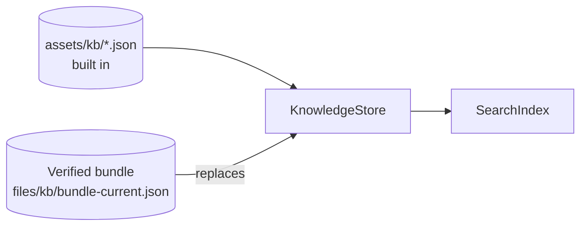

# Records

Kuya J answers only from **records**: short, dated, sourced statements of fact, each written from an official
page.

## The record format

Records live in JSON arrays, one file per category (`androidApp/src/main/assets/kb/fees.json` and so on). The
format is the same as an [Airgap](https://github.com/xmpuspus/airgap) bundle document.

```json
{
  "id": "fee-002",
  "category": "fees",
  "title": "Fees and validity for an NBI clearance",
  "content": "As of 2026-10-07, the NBI how-to page states that the basic clearance fee is PHP 130. The page adds an e-payment service charge. The official page does not state the validity period of the clearance. Check the amount on the portal before you pay. Source: https://nbi.gov.ph/how-to-apply-nbi-clearance/ (checked 2026-10-07).",
  "keywords": ["NBI clearance fee", "magkano ang NBI clearance", "bayad sa NBI", "how much is NBI clearance"],
  "tags": ["nbi", "clearance", "fees"],
  "metadata": {
    "source": "https://nbi.gov.ph/how-to-apply-nbi-clearance/",
    "publisher": "National Bureau of Investigation",
    "asOf": "2026-10-07",
    "agency": "NBI"
  }
}
```

| Field | Required | Used for |
|---|---|---|
| `id` | yes | Stable identity, used in logs, tests and evals |
| `category` | yes | The answer card's label, icon and colour; which key value it shows |
| `title` | yes | Shown to the model and searched (weight 2) |
| `content` | yes | What the model reads (first 1,200 characters) and what's shown when no model answers; searched (weight 1) |
| `keywords` | yes | Search phrases in English and Filipino, never shown (weight 3) |
| `tags` | no | Grouping |
| `metadata.source` | no | The source link on the answer card |
| `metadata.publisher` | no | "Source · National Bureau of Investigation" |
| `metadata.asOf` | no | "checked 2026-10-07" on the card |
| `metadata.agency` | no | "Fee · NBI" on the card |
| `metadata.verbatim` | no | `true` = always show as written, never reworded by the model |

`KbRecord.parseArray()` rejects a record that is missing a required field or has the wrong type, so a broken
file fails loudly instead of answering wrongly.

### Writing a good record

- **Start with "As of <date>,"** and name the page: the model copies the date, so people know how fresh the fact is.
- **State what the page doesn't say** ("The official page does not state the validity period"): that lets the model
  say "no record" instead of guessing.
- **End with `Source: <url> (checked <date>).`** The model ends its answer with this line; the app hides it from the
  text because the card already shows it.
- **Keywords are how people ask**, including Tagalog phrasing: "magkano ang NBI clearance", "bayad sa NBI".
- **Keep it under 1,200 characters**; the model sees only that much.

## The built-in records

27 records ship inside the app, copied from Airgap's government-services example. Each was written from an
official page:

| Category | Records |
|---|---|
| fees (3) | NBI clearance, SS number, passport (DFA 2022 charter) |
| holidays (4) | 2026 regular holidays, Nov-Dec 2026 special days, Eid'l Fitr, Eid'l Adha |
| hotlines (6) | 8888, 911, PSAHelpline, SSS 1455, BIR, NBI |
| officials (9) | President, Vice President, Senate President, Speaker, Chief Justice, DICT Secretary, Executive Secretary, how the President is elected, a dated Palace statement |
| requirements (2) | NBI clearance, where the DFA lists passport requirements |
| services (3) | Applying for NBI clearance, getting an SS number, the passport appointment portal |

They were last checked in October 2026. Newer records arrive through [record sync](sync.md); a harvester that turns
BetterGov.ph's public guides, hotlines, holidays and directory into records is in progress.

## Where records come from at runtime



`KnowledgeStore` holds either the built-in set or the last verified bundle (a bundle replaces the whole set, it
doesn't merge). A swap is a single write, so a search
never sees half of one and half of the other. If a bundle fails to load, the store falls back to the built-in
records.
