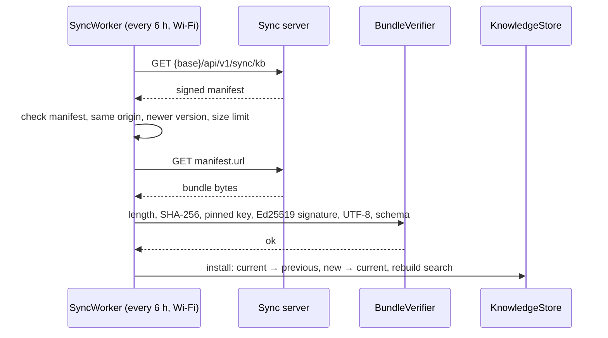

# Record sync

Records change: fees go up, officials change, new holidays are proclaimed. Kuya J can download updated records as
a **signed bundle** over Wi-Fi. The design is Airgap's: whoever controls the update server still can't push records
the app will accept unless they hold the signing key.

Sync is off until a server and key are configured; the app then runs on its built-in records only.

## The flow



## The manifest

`GET {base}/api/v1/sync/kb` returns:

| Field | Must be |
|---|---|
| `algorithm` | `Ed25519` |
| `signatureEncoding` | `base64` |
| `byteLength` | Exact size of the bundle |
| `sha256` | Lowercase hex SHA-256 of the bundle |
| `version` | Release ID; numbers or an ISO time, compared digit group by group |
| `keyId` | First 16 hex characters of SHA-256 over the raw public key |
| `url` | HTTPS, on the same origin as the base URL |
| `publishedAt` | ISO date-time |
| `signature` | Base64 Ed25519 signature over the exact bundle bytes |

## The bundle

```json
{ "files": { "fees.json": "[ ...records as a JSON string... ]", "hotlines.json": "[ ... ]" },
  "generatedAt": "2026-12-01T00:00:00Z" }
```

Each file is the same JSON array as `assets/kb/`. The signature covers these exact bytes, so nothing may re-format
the JSON between signing and download.

## Every check before a byte is trusted

1. The manifest has every field, the right algorithm, and an HTTPS URL on the configured origin. Redirects are
   refused.
2. The version is newer than the installed one (an older or equal version is skipped, so a replayed old bundle
   can't roll records back).
3. The bundle is at most 50 MB, and the download stops if it grows past the declared length.
4. Length and SHA-256 match the manifest.
5. The `keyId` is one of the app's **pinned public keys**, and the Ed25519 signature verifies.
6. The bytes are valid UTF-8, `generatedAt` is a date, and every record parses with its required fields.

Any failure leaves the current records untouched. Network errors are retried; a bad signature is not, since a retry
won't fix it.

## Installing

`BundleSync.install()` writes the new bundle to a partial file, moves the current bundle to `bundle-previous`,
moves the new one into place, and rebuilds the search index. If loading fails, it restores the previous bundle.
The version is saved only after all of that succeeds. On the next start, `loadInstalled()` loads the current
bundle, or falls back to the built-in records.

## Configuring

In `gradle.properties`:

```properties
kuyaj.syncBaseUrl=https://chat.bettergov.ph
kuyaj.syncPublicKeys=<keyId>:<base64 Ed25519 public key>
```

Several keys may be listed, comma-separated. That allows rotating keys: ship an app that trusts the old and new
key, sign with the new one, then drop the old key in a later release. The **private** key never goes in the app or
any repository.

Debug builds may also sync over plain HTTP from `10.0.2.2` (the emulator's host), for a local test server; release
builds require HTTPS.

## When it runs

`SyncWorker` (WorkManager) runs every 6 hours on an unmetered network (Wi-Fi), and once at startup. *Update on next
Wi-Fi* in Settings queues an immediate run that still waits for Wi-Fi. After every run the settings sheet's
freshness updates, and answers carry a [staleness note](answering.md#staleness) when records are over a day old.

Tested in `BundleVerifierTest`: a genuine bundle passes; a changed byte, an attacker's bundle with a matching hash,
an unpinned key, and HTTP in a release build are all rejected; versions order correctly.
