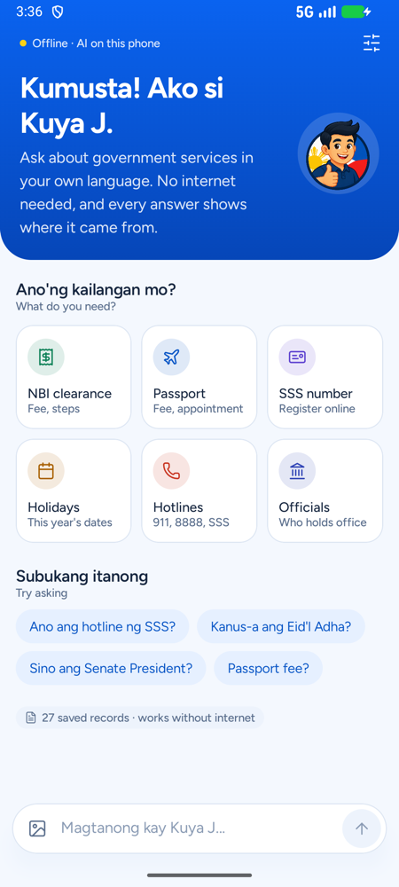
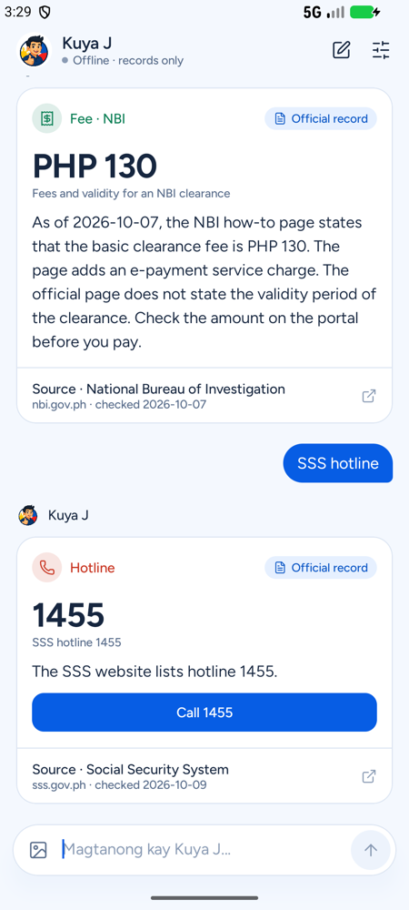
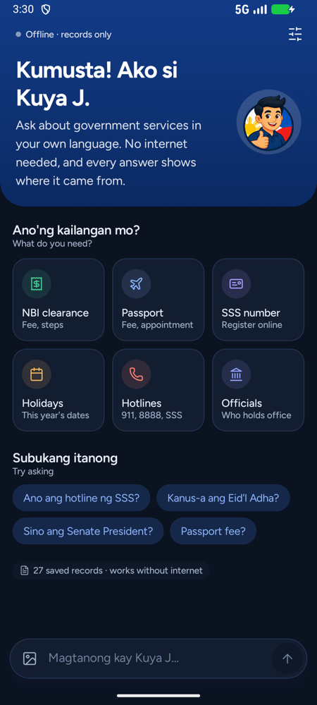
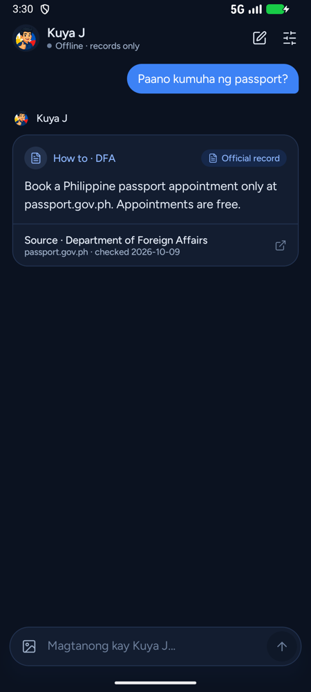

# The app UI

All screens are Compose Multiplatform code in `shared/src/commonMain/kotlin/ph/bettergov/kuyaj/ui/`, so they will
run unchanged on iOS. Components come from [Compose Unstyled](https://composables.com/compose-unstyled), which
gives behaviour and accessibility without a look; Kuya J styles everything itself.

| File | What it holds |
|---|---|
| `App.kt` | `KuyaJApp(...)`: the root, the chat screen with the settings sheet over it |
| `ChatScreen.kt` | Home, the conversation, answer cards, the message composer |
| `SettingsSheet.kt` | Records status, the AI model, About |
| `AnswerFacts.kt` | `keyFact()`: the one value an answer card shows large |
| `Categories.kt` | Label, icon and colour per record category |
| `Theme.kt` | Colours (light and dark), the Figtree type scale |
| `Components.kt` | Buttons, icon buttons, pills, the typing dots |
| `ChatViewModel.kt` | Messages, the busy flag, the attached photo |

## Home

- **Welcome band** in BetterGov blue with the mascot, the greeting *Kumusta! Ako si Kuya J.* and one line on what
  Kuya J promises: your language, no internet, sources.
- **Status** at the top: *Offline · AI on this phone* (sun-yellow dot) once the model is loaded, *Offline ·
  records only* before.
- **Topic tiles** (*Ano'ng kailangan mo?*): NBI clearance, Passport, SSS number, Holidays, Hotlines, Officials.
  Each asks a question the built-in records can answer. Colours match the answer cards.
- **Example questions** (*Subukang itanong*) in Tagalog, Cebuano and English, so people see they can ask in their
  own language.
- **Record count**: how many records are on the phone.

Headings are Filipino first with English under them. Edit `TOPICS` and `EXAMPLES` in `ChatScreen.kt` when records
change; a topic should only ask what the records can answer.

 

## Answer cards

Any answer that comes from a record (`RECORD` or `MODEL` reply) is a card:

1. **Header:** the category and agency (*Fee · NBI*), and a badge: *Official record* (shown as written) or
   *Checked against record* (the model's wording, which passed the [grounding check](safety.md#the-grounding-check)).
2. **Key value**, large: a fee (PHP 130), a hotline (1455), or a date (20 March 2026), with the record's title
   under it.
3. **The answer text**, without its trailing source line.
4. **A note** if the AI answer was withheld or timed out.
5. **Call button** for hotlines: opens the dialer with the number filled in.
6. **Source row:** publisher, website, and the date: "checked" when someone verified the source then, "listed"
   when it's the date BetterGov.ph last listed it ([why](records-pipeline.md#dates-checked-or-listed)). Tap to
   open the page.

### Where the key value comes from

`keyFact(record)` takes the value **from the record, never from the model's text**, so the large number is always
one the record contains:

| Category | Value | Rule |
|---|---|---|
| fees | The fee: `₱160`, `PHP 130` | Only when the first sentence states one amount, either at its start ("₱160 total.") or after "fee is". Several prices, a minimum or a cap shows no value. |
| hotlines | The number in the title (`SSS hotline 1455`), else the first full phone number in the content | Years are never taken as numbers |
| holidays | A single date in the title, written as `20 March 2026` | A list of dates shows no value |
| others | none | |

`KeyFactTest` checks this against every built-in record, including that each value appears in its record.

Refusals show in a grey box; greetings and other system replies are plain text.

 

## Settings

Opened from the sliders icon. Three sections:

- **Records:** built in or downloaded, how many, the bundle version, the last update, and freshness when a sync
  server is set. *Update on next Wi-Fi* queues a sync.
- **AI model:** which model, its size, the backend it runs on (NPU, GPU or CPU), and the download controls:
  *Download on Wi-Fi*, a progress bar, *Delete model*.
- **About:** the BetterGov.ph logo and a reminder to check the agency's page before acting.

## Theme

- **Colours:** BetterGov blue (`#075DE4`) as primary, the Philippine flag's sun yellow as a small highlight, one
  accent per category (fees green, requirements violet, hotlines red, holidays amber, officials indigo).
  Every colour has a dark-mode value; the app follows the system setting.
- **Type:** Figtree, one scale in `Type` (hero 30, figure 34, display 26, title 17, body 16, small 14, caption 12).
- **Status bar:** white icons over the blue welcome band and in dark mode, dark icons over the light chat
  (`MainActivity`).

 

## Accessibility

- Buttons and tiles are real buttons (`Role.Button`), with labels on icon-only buttons ("Settings", "New chat",
  "Send", "Attach a photo").
- Body text is 16 sp and scales with the system font size.
- Colour is never the only signal: each card also says its category and kind in words.
